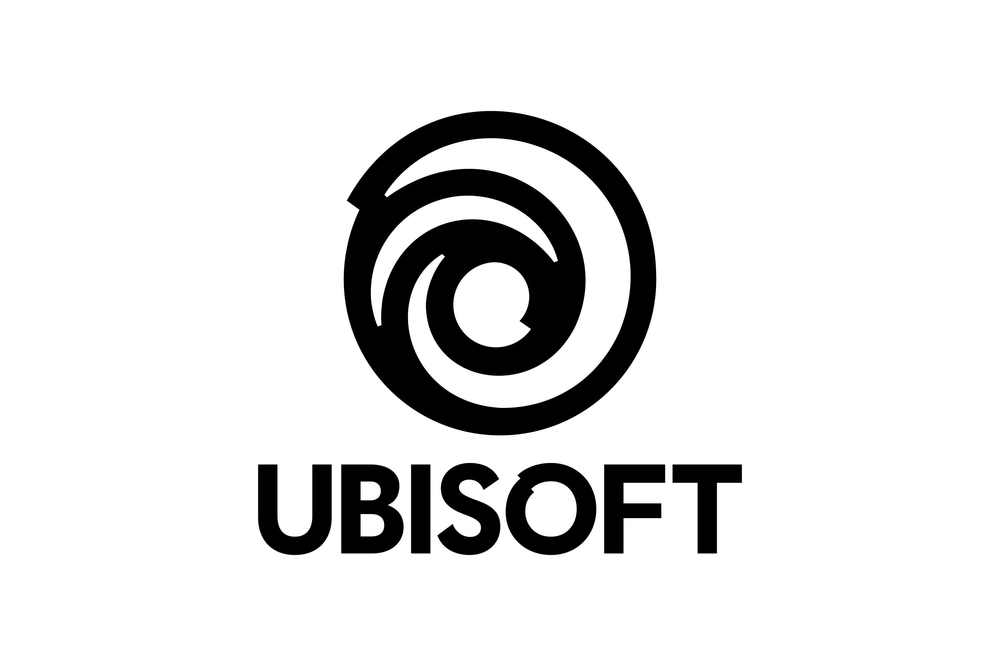
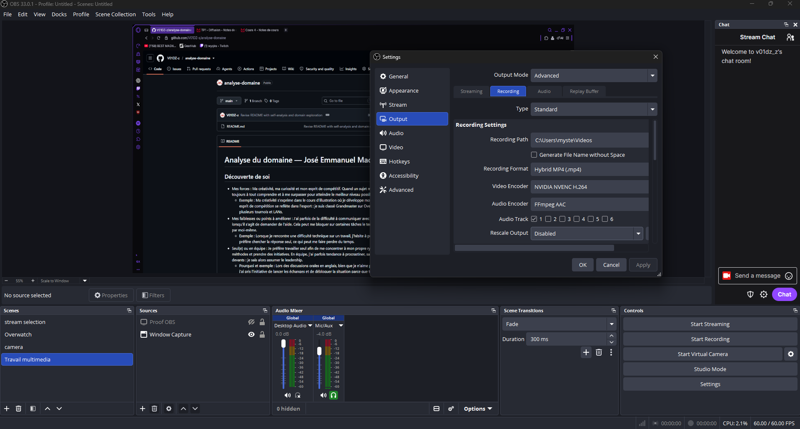

# Analyse du domaine — José Emmanuel Machin Garcia

## Découverte de soi

- Mes forces : Ma créativité, ma curiosité et mon esprit compétitif. Quand un sujet me passionne, je cherche toujours à tout comprendre et à me surpasser pour atteindre le meilleur niveau possible.
  - Exemple : Ma créativité s'exprime dans le cours d'illustration où je développe mon propre style visuel. Mon esprit de compétition se reflète dans l'esport : je suis classé Grandmaster sur Overwatch et j'ai remporté plusieurs tournois et LANs.
- Mes faiblesses ou points à améliorer : J'ai parfois de la difficulté à communiquer avec les autres, particulièrement lorsqu'il s'agit de demander de l'aide. Cela peut me bloquer sur certaines tâches le temps que je trouve la solution par moi-même.
  - Exemple : Lorsque je rencontre une difficulté technique sur un travail, j'hésite à poser des questions et je préfère chercher la réponse seul, ce qui peut me faire perdre du temps.
- Seul ou en équipe : Je préfère travailler seul afin de me concentrer à mon propre rythme, utiliser mes propres méthodes et prendre des initiatives. En équipe, j'ai parfois tendance à procrastiner, sauf si personne ne prend les devants : je sais alors assumer le leadership.
  - Pourquoi et exemple : Lors des discussions orales en anglais, bien que je n'aime pas parler devant les autres, j'ai pris l'initiative de lancer les échanges et de débloquer la situation parce que tout le monde hésitait à s'exprimer.
- Plutôt technique ou créatif : Je me sens plus à l'aise dans les tâches créatives. Elles me permettent de créer un lien direct avec mes passions et de m'exprimer plus librement qu'avec des tâches purement techniques.

## Exploration des domaines

| Domaine | Intérêt | Pourquoi |
|---|---|---|
| Graphisme | Super Fort | J'aime créer de belles choses visuelles en profitant d'une approche accessible et créative. |
| Vidéo et animation 2D | Super Fort | Je fais déjà du montage pour mes propres vidéos et c'est une passion d'assembler du contenu visuel. |
| 3D | Fort | Je trouve fascinant le processus de sculpter et de passer d'un simple cube à un modèle ultra-détaillé. |
| Web | Faible | Ce domaine demande beaucoup de programmation, ce qui ne m'attire pas du tout. |
| Jeux vidéo | Super Fort | J'adore y jouer, explorer le concept art et j'aimerais même faire du doublage (voice acting) dans un jeu. |
| Développement logiciel | Faible | La programmation pure et le code complexe sont des tâches trop techniques pour moi. |
| Installations et expériences immersives | Moyen | C'est un univers immersif, ludique et stimulant qui fait travailler l'imagination. |

## Mes 2 domaines préférés

### Domaine 1 : Vidéo et animation 2D

- Expérience : J'ai déjà de l'expérience personnelle en montage vidéo, ce qui rend des cours comme audio et vidéo beaucoup plus faciles, fluides et agréables à suivre.
- Logiciels et outils : J'utilise principalement CapCut, et j'ai de l'expérience avec Adobe Premiere Pro, After Effects et Clipchamp. J'aimerais aussi approfondir mes compétences en animation 2D.
- Pourquoi il m'intéresse : Ce domaine m'attire parce que j'aime manipuler les images et le son pour raconter une histoire de manière dynamique.
- Travailler dans ce domaine : Oui, je me vois bien travailler là-dedans puisque c'est un domaine stimulant, accessible et qui correspond directement à mes passions créatives.

### Domaine 2 : Jeux vidéo

- Expérience : J’ai un peu d'expérience, j'ai été testeur de jeux pour essayer des patchs avant leur sortie officielle, mod, j'ai créé des sprites 2D, personnages et animations sur Construct pour un projet scolaire, et j'ai déjà fait des auditions pour du voice acting dans des jeux.
- Logiciels et outils : J'ai des bases sur Blender grâce à mon DEP, je connais Construct et j'aimerais continuer d'explorer les moteurs de jeux ainsi que le concept art et le doublage vocal (photoshop, audacity, reaper, illustrator, etc).
- Pourquoi il m'intéresse : Ce domaine m'intéresse énormément parce que je suis un grand passionné de jeux et j'aimerais contribuer à la création d'un grand projet.
- Travailler dans ce domaine : Oui, j'aimerais y travailler un jour pour participer activement à la création d'univers interactifs et immersifs qui marquent les joueurs.

## Les caractéristiques de mon domaine préféré

- Types d'entreprises : Studios de développement de jeux vidéo et studios de création audiovisuelle.
- Exemple d'entreprise : Ubisoft (ou un autre studio comme Blizzard, etc)

(source de l'image : https://www.logo.wine/logo/Ubisoft)

- Types de produits et de services : Jeux vidéo (PC, consoles, mobiles), contenu téléchargeable (DLC) et univers interactifs 3D.
- Étapes de production : Idéation/recherche : Concept et mécaniques de jeu, analyse du public cible, prototypage rapide. / Préproduction : Document de conception (*Game Design Document*), direction artistique et prototype jouable.  / Production : Création des personnages, décors et sons, conception des niveaux (*level design*) et programmation.  /  Postproduction : Tests d'assurance qualité (QA), correction de bogues et équilibrage.  /  Opération : Correctifs, mises à jour et gestion de la communauté.
- Type d'emploi visé : Concept Artist, Concepteur 2D/3D ou Testeur QA / voice actor.
- Étapes pour obtenir cet emploi : Réaliser une formation collégiale en multimédia, développer un portfolio solide avec des projets 2D/3D et effectuer un stage en studio et faire des auditions.

## Conclusion

- Mon profil en une phrase : Je suis un créatif curieux et compétitif qui souhaite concevoir des projets dans l'univers des jeux vidéo.
- Ce qui m'a surpris : Réaliser à quel point mes expériences personnelles et de gaming (esport, testeur, création 2D) se connectent directement au multimédia.
- Ma force principale et la faiblesse à travailler : Ma curiosité et ma créativité m'aideront beaucoup, mais je dois travailler en priorité sur ma communication pour oser demander de l'aide plus facilement.
- Mon action d'ici la fin de la session : Suivre un tutoriel pour approfondir mes bases sur Blender et les moteurs de jeux, etc...

## Ma capsule

